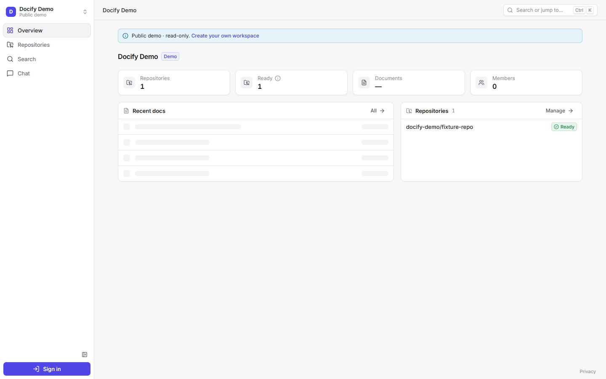
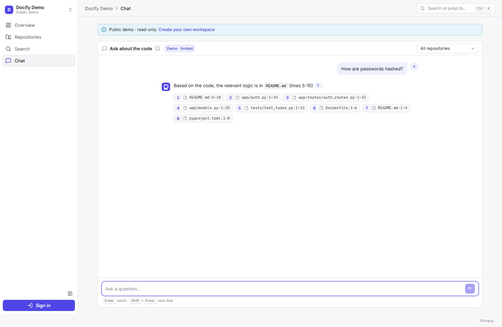
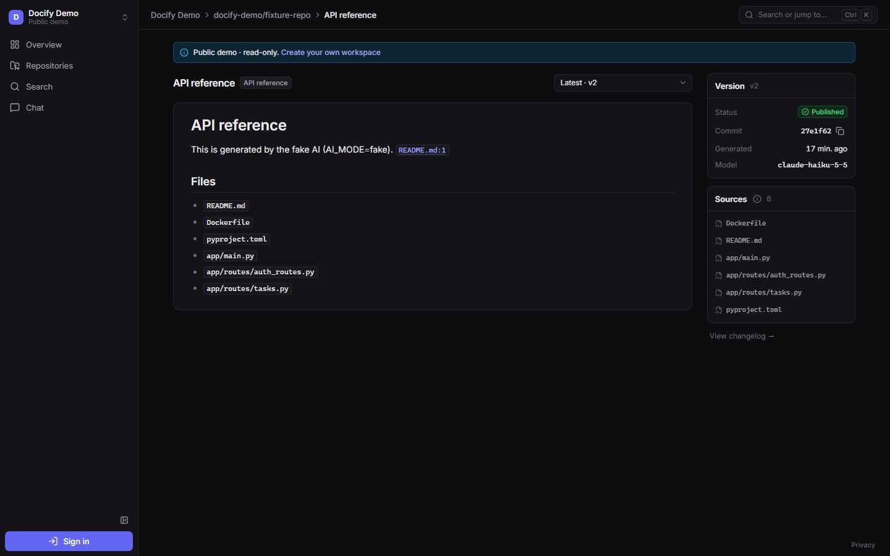
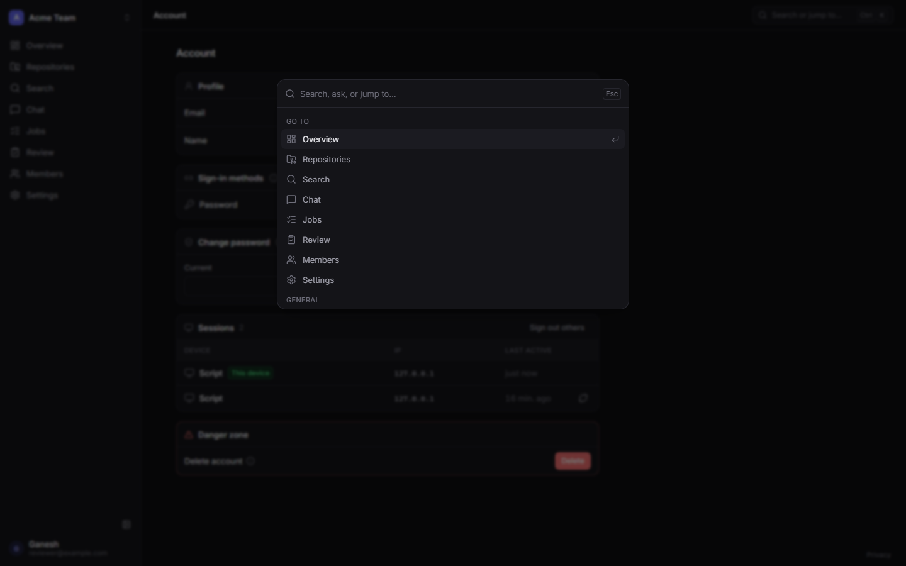

# Docify

> Docify reads a GitHub repo, writes documentation for it with AI, keeps that documentation updated when the code changes, and lets people search and chat with it — answers link to the exact file lines and commits ("who added this, and when?").

**Live:** [docify.work](https://docify.work) (prod) · [staging.docify.work](https://staging.docify.work) — the server sleeps from 23:00 IST; *Actions → Start Docify* wakes it in ~2 min.

The app is the excuse — the real goal is to learn **DevOps, Cloud, System Design and Scaling** by building, shipping and running a real product end to end on a small budget.

| | |
|---|---|
|  |  |
|  |  |

## Stack

| Area | Stack |
|---|---|
| Frontend | Vite + React 19 + TypeScript + Tailwind v4, Radix primitives, TanStack Query (static SPA on S3 + CloudFront) |
| Backend | Python 3.13 · FastAPI · SQLAlchemy 2 (async) · Alembic · server-side sessions · GitHub/Google OAuth |
| Worker | SQS consumer with row leases + fencing, coalescing, retries, reconciler |
| Data | Postgres 17 + pgvector (hybrid vector + full-text search) · Valkey 8 |
| AI | Amazon Bedrock: Nova Micro (summaries, changelog) + Nova Lite (docs, chat) · Titan Text Embeddings V2 (pluggable: Anthropic + Voyage also supported) |
| Platform | k3s on one EC2 instance · Argo CD (GitOps, app-of-apps) · Helm · cert-manager · External Secrets · KEDA · Traefik |
| Infra | Terraform (S3 backend) · CloudFront · Lambda webhook ingest → SQS · SSM · SES · Route 53 · ECR · EventBridge Scheduler |
| CI/CD | GitHub Actions (SHA-pinned) with OIDC · Trivy · hadolint · kubeconform · tflint · staging → prod promotion with approval |
| Scaling | HPA (api 2→3), KEDA on SQS depth (workers 0→3→0), k6 load tests; EKS lab with Cluster Autoscaler + Pod Identity + RDS |
| Observability | Prometheus · Grafana (dashboards + alerts as code → SNS e-mail) · Loki · Alloy · postgres-exporter |

## Status

All 14 phases done + code-health features (D66) (tracker: [`docs/Docify_Master_Doc.md`](docs/Docify_Master_Doc.md) §1, §23).

| Proven | How |
| --- | --- |
| Real users, real repos | GitHub + Google login, GitHub App install, docs/changelog regenerate on every push |
| Code health | **Insights** (who did what, activity, PRs, health score), **Checks** (policy flagging on every push, attributed to the commit author), **Issues** (likely-responsible contributor with evidence, one-click assign) |
| Scaling | k6 50 VUs × 10 min on prod: 30,668 requests, **0 errors, p95 107 ms**; api HPA 2→3→2; 500-message burst → KEDA workers 0→3→0 |
| Resilience | 5 chaos tests with incident notes ([`docs/incidents/`](docs/incidents)): pod kill (0 failed requests), worker killed mid-job (finished exactly once), Postgres down 60 s (self-healed), bad release (0 downtime), forced 5xx (alert e-mailed) |
| Recovery | restore drill: latest S3 backup → verified DB in **20 s** (RTO target 30 min) |
| Portability | same Helm chart on **EKS + RDS** for one evening (node scale-out 3→5, KEDA, Pod Identity), destroyed the same night |
| Cost | ≈ $26/month in demo mode, paid from AWS credits, $0 on the card ([`docs/Cost_Report.md`](docs/Cost_Report.md)) |

## Quick start (local)

Requirements: Docker Desktop, [uv](https://docs.astral.sh/uv/), Node 22.12+.

```bash
cp .env.example .env
docker compose up -d postgres valkey elasticmq mailpit     # Postgres :55432, Valkey :56379, SQS :9324, Mailpit :8025
cd backend && uv sync && uv run docify migrate
uv run docify seed-demo --from-dir src/docify/demo/eval_data/fixture-repo   # public "demo" workspace
uv run docify api --reload          # http://localhost:8000/api/docs
uv run docify worker                # in another terminal
cd ../frontend && npm ci && npm run dev                      # http://localhost:5173
```

Or run everything in containers (the same image CI ships): `docker compose up -d --build`.

Tests: `cd backend && uv run pytest -q` · `cd frontend && npm test -- --run`. All `make` targets are listed in the [`Makefile`](Makefile) (each is a one-line command you can also run by hand on Windows).

## Repository layout

```text
backend/      FastAPI app, worker, jobs, AI, GitHub integration (Python package `docify`)
frontend/     React SPA (design tokens + shared UI kit in src/components/ui)
lambdas/      webhook-ingest Lambda (GitHub → SQS)
deploy/       Helm charts, Argo CD app-of-apps, per-env values, dashboards
infra/        Terraform (bootstrap, modules, envs) + server bootstrap script
scripts/      smoke tests, ops helpers
docs/         plan, master doc (spec + tracker), screenshots, incident notes
```

## Docs

- [`docs/Docify_Project_Plan.md`](docs/Docify_Project_Plan.md) — the simple plan: why, what, scope and budget.
- [`docs/Docify_Master_Doc.md`](docs/Docify_Master_Doc.md) — the full technical spec, decision log and live tracker.
- [`deploy/README.md`](deploy/README.md) · [`infra/README.md`](infra/README.md) — how the platform and AWS pieces fit together.
- [`docs/Demo_Script.md`](docs/Demo_Script.md) — the 10-minute interviewer walkthrough · [`docs/Cost_Report.md`](docs/Cost_Report.md) · [`docs/Security_Review.md`](docs/Security_Review.md) · [`docs/incidents/`](docs/incidents)

## Licence

[MIT](LICENSE)
