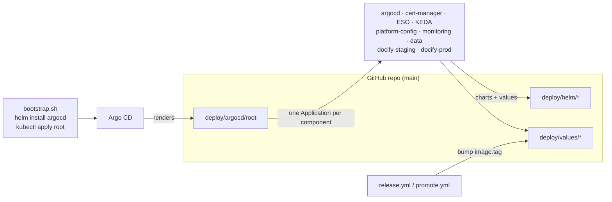

# deploy/ — Kubernetes deployment layer

Everything that runs inside Kubernetes, described as code. Spec: `docs/Docify_Master_Doc.md` §13 (platform), §5.5 (data), §15 (config/secrets), §16 (observability), §18.1 (backups), §20.2 (local kind).

```text
deploy/
├── helm/
│   ├── docify/            app chart: api, worker, valkey, migrate hook, cronjobs,
│   │                      ingress + certificate, HPA/PDB, KEDA, NetworkPolicies, secrets
│   ├── data/              Postgres 17 + pgvector, static PV, db-bootstrap hook, pg-backup, NetworkPolicies
│   └── platform-config/   ClusterIssuers, ClusterSecretStore, deny-imds policies
├── argocd/
│   ├── root/              app-of-apps for k3s (one Application per component, enabled flags, waves)
│   ├── local/             app-of-apps for kind
│   └── bootstrap/         root Application manifests (cloud example + local)
├── values/
│   ├── local.yaml staging.yaml prod.yaml eks-lab.yaml   docify chart, per environment
│   ├── data-local.yaml                                   data chart on kind
│   └── platform/          third-party chart values + dashboards/ (Grafana dashboards, alerts)
├── kind/kind-config.yaml  1-node kind cluster, localhost:8080 -> Traefik
└── validate.sh            helm lint + template + kubeconform for everything (CI "chart" job)
```

## 1. The big picture



- **Argo CD app-of-apps (D12).** `deploy/argocd/root` is a tiny Helm chart. Its only output is Argo CD `Application` objects, one per component, each behind `apps.<name>.enabled`.
- **Releases are commits.** CI builds `docify/backend:<sha>` and a bot commits the new `image.tag` into `deploy/values/staging.yaml` (and, after approval, `prod.yaml`). Argo CD notices the commit and rolls out. Rollback = `git revert` of the bump commit.
- **Self-healing.** Every Application has `automated: {prune: true, selfHeal: true}`, so a manual `kubectl edit` gets reverted (F37).

## 2. Sync waves (order of creation)

| Wave | Application | Why this order |
| ---- | ----------- | -------------- |
| -10 | `argocd` | Argo CD manages its own upgrades |
| -5 | `cert-manager`, `external-secrets`, `keda` | operators + CRDs first |
| -4 | `platform-config` | ClusterIssuers / ClusterSecretStore need the CRDs from -5 |
| 0 | `monitoring` | Prometheus CRDs before apps' ServiceMonitors |
| 5 | `data` | Postgres before the apps |
| 10 | `docify-staging`, `docify-prod` | the app |

The root only waits for a wave to be **Healthy** because `deploy/values/platform/argocd.yaml` adds a health check for `Application` resources (`resource.customizations.health.argoproj.io_Application`) — without it, Argo CD treats child Applications as instantly healthy (V19).

**Inside** each app chart there are waves too:

| docify chart | data chart |
| ------------ | ---------- |
| -2 ConfigMap, ServiceAccount, ExternalSecrets, NetworkPolicies | -2 ExternalSecret `postgres-passwords`, NetworkPolicies |
| -1 **migrate** Job (Argo `Sync` hook, D28) | -1 PV + PVC |
| 0 Deployments, Services, Ingress, HPA, KEDA, CronJobs… | 0 StatefulSet, Services, CronJob |
| | 1 **db-bootstrap** Job (Argo `Sync` hook) |

Hooks are not part of app health, so `migrate` may start before `db-bootstrap` finished on a fresh cluster; `docify migrate` retries the DB for 5 min and the Application retries (`limit 10`, backoff 30 s → 5 min) cover the rest (§13.2).

## 3. Phase gating — what to flip when

Edit `deploy/argocd/root/values.yaml`, open a PR, merge. Argo CD creates/deletes the Applications.

| Phase | Set `enabled: true` | Also |
| ----- | ------------------- | ---- |
| P8 (default in Git) | `argocd`, `certManager`, `externalSecrets`, `platformConfig` | — |
| P9 | + `keda`, `data`, `docifyStaging`, `docifyProd` | fill GitHub/Google ids in `values/{staging,prod}.yaml`; switch `certificate.issuerName` to `letsencrypt-prod` once a staging cert works |
| P10 | + `monitoring` | set `serviceMonitor.enabled: true` in `values/{staging,prod}.yaml` |

Disabling an app deletes its resources (resources-finalizer) — **except** `data` and `argocd`, which have no finalizer so Postgres and Argo CD are never cascade-deleted. The Postgres PV/PVC additionally carry `Prune=false,Delete=false` and `helm.sh/resource-policy: keep`.

## 4. Account id injection (public repo)

Nothing account-specific is committed (CLAUDE.md). Values files hold placeholders:

| Value | Placeholder in Git | Used for |
| ----- | ------------------ | -------- |
| `aws.accountId` | `"000000000000"` | SQS URLs `https://sqs.ap-south-1.amazonaws.com/<acct>/docify-<env>-events`, buckets `docify-repo-cache-<acct>` / `docify-backups-<acct>`, ECR image `<acct>.dkr.ecr.ap-south-1.amazonaws.com/docify/backend`, SNS topic ARN |
| `aws.hostedZoneId` | `"Z00000000000000000000"` | cert-manager DNS-01 solver |

How the real values arrive:

1. Terraform renders `infra/server/bootstrap.sh` with the account id and zone id.
2. bootstrap.sh applies the **root Application** (template: `argocd/bootstrap/root-application.example.yaml`) with Helm **parameters** `global.aws.accountId` and `global.aws.hostedZoneId`. The root Application itself is not stored in Git.
3. The root chart forwards them as Helm parameters to the children (`aws.accountId` → data/docify apps, `aws.hostedZoneId` → platform-config, `grafana.env.AWS_ACCOUNT_ID` → monitoring). Parameters override value files.

So the release workflow only ever touches `image.tag`, and `helm template` in CI renders valid-looking URLs with the placeholder. The docify chart prints a warning in `NOTES.txt` if a cloud env renders with the placeholder.

## 5. How Argo CD finds charts and values

- **Our own charts** (`deploy/helm/docify`, `data`, `platform-config`): single-source, **path-based** Applications. Value files are resolved relative to the chart directory, so the root renders `valueFiles: [../../../deploy/values/staging.yaml]` (Argo CD allows files outside the chart as long as they are inside the repo). One source = normal history/rollback in the UI.
- **Upstream charts** (argo-cd, cert-manager, external-secrets, keda, kube-prometheus-stack, loki, alloy, traefik): **multi-source** Applications — source 1 is the pinned chart, source 2 is this repo with `ref: values`, and source 1 reads `$values/deploy/values/platform/<chart>.yaml`.
- **Loki** moved to an OCI-only registry (`ghcr.io/grafana-community/helm-charts`, V21). `deploy/values/platform/argocd.yaml` declares that registry as an OCI Helm repo (`enableOCI: "true"`).
- **Monitoring config** (`deploy/values/platform/dashboards/`) is a kustomize directory: dashboards JSON → ConfigMaps labelled `grafana_dashboard=1`, `alerting.yaml` → ConfigMap labelled `grafana_alert=1` (rules, SNS contact point, policy), plus the Grafana admin ExternalSecret and the monitoring namespace's IMDS NetworkPolicies.

### Pinned versions (2026-10-21)

| Component | Chart | Version (app) |
| --------- | ----- | ------------- |
| Argo CD | argo/argo-cd | 10.10.5 (v3.5.5) |
| cert-manager | jetstack/cert-manager | v1.21.2 |
| External Secrets | external-secrets/external-secrets | 2.13.0 |
| KEDA | kedacore/keda | 2.21.0 |
| kube-prometheus-stack | prometheus-community/kube-prometheus-stack | 92.11.0 (operator v0.94.1, Grafana 13.2.4) |
| Loki | oci://ghcr.io/grafana-community/helm-charts/loki | 19.0.1 (3.7.9) |
| Alloy | grafana/alloy | 1.14.0 (v1.21.0) |
| Traefik (kind only) | traefik/traefik | 42.1.0 (v3.7.15) |
| Postgres | image `pgvector/pgvector` | 0.8.7-pg17 (PostgreSQL 17.11) |
| Valkey | image `valkey/valkey` | 8.1.10-alpine |
| backup dump / upload | `postgres` / `amazon/aws-cli` | 17.11-bookworm / 2.38.3 |
| ElasticMQ / Mailpit (kind) | `softwaremill/elasticmq-native` / `axllent/mailpit` | 1.7.1 / v1.31.6 |

## 6. Local flow (kind) — P6 and P7

Prereqs: Docker Desktop, `kind`, `kubectl`, `helm`. Backend image built locally as `docify-backend:dev`.

```bash
# 1. cluster (localhost:8080 -> Traefik)
kind create cluster --config deploy/kind/kind-config.yaml
kind load docker-image docify-backend:dev --name docify
```

**P6 — plain Helm (learn the charts first):**

```bash
helm repo add traefik https://traefik.github.io/charts
helm install traefik traefik/traefik --version 42.1.0 -n traefik --create-namespace \
  -f deploy/values/platform/traefik-kind.yaml

kubectl create namespace data
kubectl label namespace data pod-security.kubernetes.io/enforce=baseline
helm install data deploy/helm/data -n data -f deploy/values/data-local.yaml

kubectl create namespace docify-local
kubectl label namespace docify-local pod-security.kubernetes.io/enforce=restricted
helm install docify deploy/helm/docify -n docify-local -f deploy/values/local.yaml

curl http://localhost:8080/api/health
kubectl -n docify-local port-forward svc/mailpit 8025:8025   # emails at http://localhost:8025
```

With plain Helm, `migrate` and `db-bootstrap` run as Helm `post-install/post-upgrade` hooks (Argo CD ignores those annotations because its own `argocd.argoproj.io/hook` takes precedence).

**P7 — GitOps on kind:**

```bash
helm repo add argo https://argoproj.github.io/argo-helm
helm install argocd argo/argo-cd --version 10.10.5 -n argocd --create-namespace \
  -f deploy/values/platform/argocd.yaml
kubectl apply -f deploy/argocd/bootstrap/root-local.yaml
kubectl -n argocd get applications -w
# UI: kubectl -n argocd port-forward svc/argocd-server 8081:443
#     password: kubectl -n argocd get secret argocd-initial-admin-secret -o jsonpath='{.data.password}' | base64 -d
```

Argo CD reads from GitHub (`main`): to demo GitOps, change `image.tag` (or `api.replicas`) in `deploy/values/local.yaml`, push, watch Argo roll it out; then `kubectl -n docify-local scale deploy/api --replicas=3` and watch selfHeal revert it.

Local differences: `externalSecrets.enabled=false` + `localSecrets` (throwaway dev values; put real keys in git-ignored `deploy/values/local.secrets.yaml` and add it with `-f`), no cert-manager/TLS, ElasticMQ + Mailpit in the namespace (`devServices`), KEDA off (fixed 1 worker — KEDA vs ElasticMQ is unverified, V20), Postgres on a normal PVC.

Cleanup: `kind delete cluster --name docify`.

## 7. Cloud flow (k3s on EC2) — P8+

1. `bootstrap.sh` (cloud-init) installs k3s, then `helm install argocd argo/argo-cd --version 10.10.5 -n argocd -f deploy/values/platform/argocd.yaml` (**same values** as the `argocd` Application, so Argo CD adopts its own release), then applies the root Application with the real account/zone ids (§4 above).
2. Argo CD syncs the root → wave -10 … 10 as enabled in `deploy/argocd/root/values.yaml`.
3. Secrets: SSM Parameter Store → External Secrets → K8s Secrets (`docify-app`, `docify-db`, `postgres-passwords`, `grafana-admin`). Rotation: runbook R6.
4. Access: SSM port-forward to 6443 (R2); UIs via `kubectl port-forward` (R3).

## 8. Security model in one table

| Control | Where |
| ------- | ----- |
| Pod Security Admission: `restricted` on `docify-*`, `baseline` on `data` + operators, `privileged` on `monitoring` | root chart `managedNamespaceMetadata` |
| Non-root (uid 10001), read-only root FS, no caps, seccomp RuntimeDefault, no SA token | docify chart pod defaults |
| Default-deny NetworkPolicies; only Traefik → api:8000, monitoring → :9000, app → valkey/postgres, DNS | `helm/docify/templates/networkpolicy-*.yaml`, `helm/data/templates/networkpolicy.yaml` |
| IMDS (instance role) reachable only by api/worker/reconcile, pg-backup, Grafana, and the operator namespaces that need it (D16) | `net-aws` label in docify chart, `net-backup` in data chart, `deny-imds` in platform-config + monitoring config |
| Postgres reachable only from app pods in `docify-<env>` + bootstrap/backup pods | data chart NetworkPolicy |
| Each env has its own DB role; `REVOKE CONNECT … FROM PUBLIC` | db-bootstrap Job |

## 9. Backend contract (what the image must provide)

| Item | Contract |
| ---- | -------- |
| User | runs as uid/gid 10001, works with a read-only root FS; only `/tmp` is writable |
| Commands | `docify api` · `docify worker` · `docify migrate` · `docify reconcile` · `docify housekeeping` (`docify seed-demo` run manually via `kubectl run`/Job) |
| api ports | HTTP `:8000`, Prometheus `/metrics` on `:9000` |
| api probes | `GET /api/health` (liveness/startup, no DB), `GET /api/ready` (DB ping); both without `X-Origin-Verify` |
| worker | `/metrics` on `:9000`; touches `/tmp/worker-heartbeat` at least every 30 s (liveness fails if older than 2 min); `/bin/sh` + `find` must exist in the image; drains on SIGTERM within 120 s |
| migrate | retries the DB connection for up to 5 min, then `alembic upgrade head` |
| Env (ConfigMap `docify-config`) | all non-secret vars of §15.1 (empty ones omitted) |
| Env (Secret `docify-app`) | `SESSION_PEPPER`, `ORIGIN_VERIFY_HEADER`, `GITHUB_APP_PRIVATE_KEY`, `GITHUB_CLIENT_SECRET`, `GOOGLE_CLIENT_SECRET`, `ANTHROPIC_API_KEY`, `VOYAGE_API_KEY` |
| Env (Secret `docify-db`) | `DATABASE_URL=postgresql+asyncpg://docify_<env>:<pw>@postgres.data.svc.cluster.local:5432/docify_<env>` (password URL-encoded) |
| AWS credentials | default SDK chain (IMDS on k3s, Pod Identity on EKS, dummy keys + `AWS_ENDPOINT_URL_SQS` locally) |

## 10. Validate

```bash
deploy/validate.sh
# Windows, repo-local tools:
HELM=.tools/helm.exe KUBECONFORM=.tools/kubeconform.exe bash deploy/validate.sh
```

Runs `helm lint --strict` and `helm template | kubeconform -strict` (with the community CRD schema catalog) for every chart × values file, both roots, and the kustomize monitoring config.
