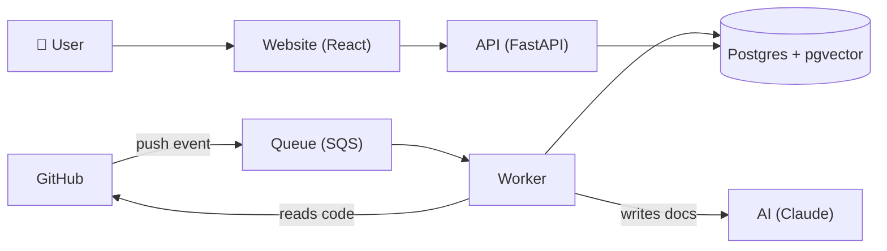

# Docify — Progress Summary (easy revision notes)

> **Last updated:** 21 Oct 2026
> **One line:** Docify connects to a GitHub repo, writes docs for it with AI, keeps them updated on every push, and lets you search and chat with the code.

---

## 1. Where we are (in one picture)

| Part | Status |
|---|---|
| Planning docs | ✅ Done |
| GitHub repo + CI | ✅ Done |
| Backend (API + worker) | ✅ Done |
| Frontend (website) | ✅ Done |
| Docker image | ✅ Done |
| Kubernetes setup (local) | ✅ Done |
| Terraform (AWS code) | ✅ Written, not applied yet |
| GitHub App (Dev) | ✅ Created and working |
| Domain `docify.work` | ✅ Bought (DNS later) |
| AWS access | 🟨 In progress |
| Real AI (Claude + Voyage) | ⏳ Waiting for API keys |
| Deploy to AWS | ⏳ Not started |
| Monitoring, load tests, chaos tests | ⏳ Code ready, run after deploy |

---

## 2. How Docify works (simple flow)

1. A user connects a GitHub repo.
2. The **worker** downloads the code, splits it into small pieces and asks the AI to write docs.
3. Everything is saved in **Postgres** (including "vectors" for smart search).
4. On every **push**, GitHub tells us, and only the changed docs are updated.
5. Users can **search** or **chat**; answers link to exact code lines.

---

## 3. What is done ✅

### 3.1 Planning
- **Project Plan** (`docs/Docify_Project_Plan.md`): the simple "why/what" plan with budget.
- **Master Doc** (`docs/Docify_Master_Doc.md`): the full technical spec + live tracker (status, decisions, tasks).

### 3.2 GitHub
- Repo: **github.com/docify-work/docify** (public).
- `main` is protected (no force-push, no delete). Secret scanning is ON.
- **CI** runs on every push: tests, lint, type checks, Docker build, security scan (Trivy), Helm and Terraform checks.

### 3.3 Backend (Python, FastAPI)
| Feature | What it means |
|---|---|
| Sign in | Email + password, **GitHub**, Google (Google needs setup later) |
| Workspaces | Teams with **Admin / Member** roles and email invites |
| Connect GitHub | Install the Docify GitHub App and pick repos |
| Background jobs | A **worker** processes repos safely (no double work, auto-retry) |
| AI docs | Overview, Setup guide, API reference + changelog per push |
| Search + Chat | Finds the right code (smart + keyword search) and answers with links |
| Safety | Secrets hidden from AI, AI budget limits, users can't see other teams' data |

- **144 automatic tests** pass.
- An independent review found **15 issues** → all fixed (e.g. account takeover, login trick, rate-limit bypass).

### 3.4 Frontend (React)
- Every page: login, dashboard, repos, docs, changelog, search, chat, jobs, review, settings, members, account.
- **Compact, professional design**, ⓘ tooltips instead of long text, smooth animations, **dark + light** mode.
- Screenshots: `docs/screenshots/`.

### 3.5 DevOps pieces (written + checked)
| Piece | What it does |
|---|---|
| **Docker** | Packs the backend into a small, safe image (96 MB) |
| **Docker Compose** | Runs everything on the laptop with one command |
| **Helm charts** | Describe how the app runs on Kubernetes |
| **Argo CD (GitOps)** | Keeps the cluster in sync with Git automatically |
| **Terraform** | Creates all AWS resources as code (not applied yet) |
| **Lambda** | Receives GitHub push events even when the server is asleep |
| **Monitoring** | Grafana dashboards + alerts written as code |
| **Load + chaos tests** | Scripts ready to prove scaling and recovery |

### 3.6 Tested on the laptop
- Whole app ran on **local Kubernetes (kind)**.
- Deleted a running API pod during traffic → **150/150 requests still OK** (no downtime).

### 3.7 Live with real GitHub
- Created GitHub App **"Docify Dev (docify-work)"**.
- Signed in with GitHub, connected the repo **docify-work/docify**, it got indexed → **Ready**.
- Chat finds the right files. (Answers are placeholder text until real AI keys are added.)

### 3.8 Accounts
- Domain **docify.work** bought.
- AWS: Supriya's **Free Plan** project **"Fresh Deploy"** ($99.98 credits, ends Apr 2027).
- Ganesh invited as a team member → **can log in** to the AWS console now.

---

## 4. What is left ⏳

### From us (owners)
1. **AWS access check:** open **EC2** in the console and confirm it works (no "not authorized" error).
2. **Connect Claude to AWS:** use "Copy agent prompt" in the AWS console → paste to Claude.
3. **AI keys:** create **Anthropic** + **Voyage** API keys (set a $5/month limit) → add to `.env`.
4. **Google login (optional):** create a Google OAuth client.

### From Claude (after access)
1. **Deploy to AWS** with Terraform (server, CloudFront, queues, Lambda, etc.).
2. **Point the domain** to AWS (Route 53) — we only paste 4 nameservers at the registrar.
3. **Staging + Prod** GitHub Apps, HTTPS certificates, emails (SES).
4. Turn on **monitoring**, then run **load tests** (auto-scaling) and **chaos tests** (break things on purpose).
5. **EKS lab** (1 day, then delete) and **final wrap-up** (diagrams, demo video, resume points).

---

## 5. Key words (quick revision)

| Word | Simple meaning |
|---|---|
| **API** | The backend that the website talks to |
| **Worker** | Background program that does slow jobs (reading repos, writing docs) |
| **Queue (SQS)** | A waiting line of jobs, so nothing is lost |
| **Docker image** | A packed box with our app + everything it needs |
| **Kubernetes (k3s)** | Runs and restarts our app's containers automatically |
| **Helm** | Templates that describe the app for Kubernetes |
| **Argo CD / GitOps** | "Git is the truth": change Git → cluster updates itself |
| **Terraform** | Write AWS setup as code instead of clicking |
| **CI/CD** | Auto test on every push / auto deploy after it passes |
| **CloudFront** | AWS's fast global front door for the website |
| **RAG** | AI answers using our own code as the source |
| **Embeddings / vectors** | Numbers that capture meaning, used for smart search |

---

## 6. Where to find things

| What | Where |
|---|---|
| Full spec + status | `docs/Docify_Master_Doc.md` |
| Simple plan | `docs/Docify_Project_Plan.md` |
| Backend code | `backend/` |
| Website code | `frontend/` |
| Kubernetes / Argo CD | `deploy/` |
| AWS (Terraform) | `infra/` |
| Run locally | `README.md` → "Quick start" |
