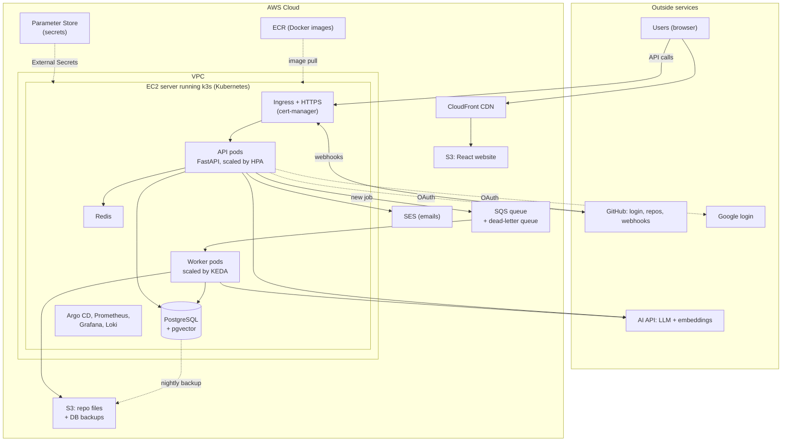
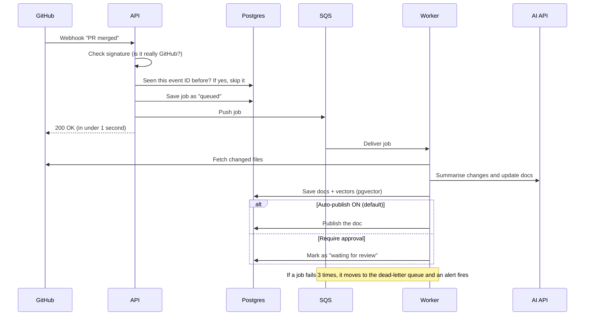
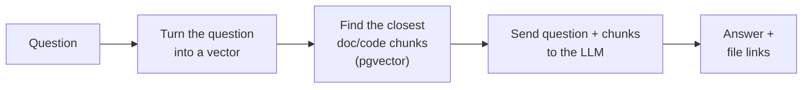
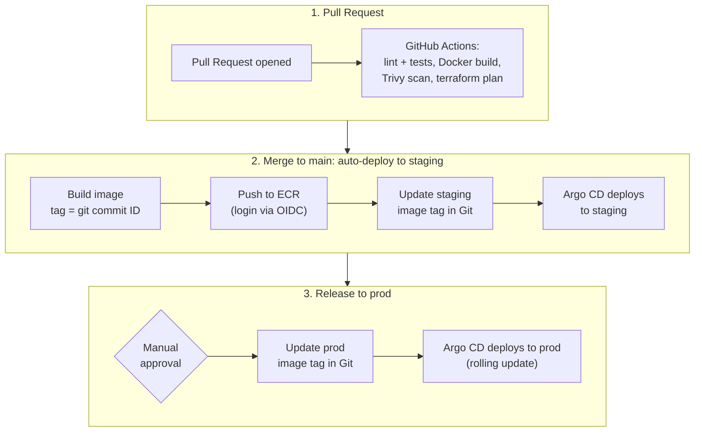

# Docify: Project Plan

> **One line:** Docify reads a GitHub repo, writes documentation for it with AI, keeps that documentation updated when the code changes, and lets people search and ask questions about it.
>
> **Real goal:** Learn **DevOps, Cloud, System Design and Scaling** properly by building, shipping and running a real product end to end, on a **small budget**.

---

## 1. Why

| | |
|---|---|
| **Main focus** | DevOps and Cloud (about 70% of the effort). |
| **Side focus** | Frontend, backend and AI (about 30%). They are kept simple on purpose. |
| **Budget rule** | New AWS accounts get up to **$200 in free credits**. Our target is to learn **everything inside these credits**, so we pay little or nothing from our own pocket. We use free tools and free tiers wherever we can. |

**Why this project?**
Most DevOps practice projects are just "deploy a to-do app". That teaches very little. Docify is better because it has the parts real companies have:

- a website and an API
- background workers that take a long time to finish
- a queue, a database, file storage and a cache
- outside services (GitHub, an AI API)
- work that comes in bursts (100 code pushes at once), which gives us a real reason to **scale**

So the app is the excuse. The real skill we're practising is the DevOps work around it.

---

## 2. Problem Statement

In software teams:

- Documentation is written by hand, so it is usually **late or missing**.
- Code changes every day, but docs don't, so docs become **outdated**.
- New people waste days asking "how does this work?"
- Non-developers (support, product, managers) can't easily find technical answers.

## 3. Idea and Solution

**Docify connects to a GitHub repo and does three things automatically:**

1. **Writes docs.** It reads the code and creates an overview, setup guide and API docs.
2. **Keeps docs fresh.** When a pull request is merged, it summarises what changed and updates the docs.
3. **Answers questions.** Anyone can ask "How does login work?" and get an answer with links to the exact files.

**Publishing is controlled by a setting.** By default, updated docs are **published automatically**. In the dashboard settings, an admin can switch this to **"Require approval"**, so a person must review each AI change before it goes live.

---

## 4. Features

### Users and sign in
| Sign-in method | Who uses it |
|---|---|
| **GitHub** | Developers and admins. Also needed to **connect repos** (GitHub integration). |
| **Google** | Normal users who just want to read, search and chat with docs. |
| **Email + password** | Same as Google, for people who don't want to use Google. Includes email verification and "forgot password". |

**Roles (kept simple):**
- **Admin:** connects repos, changes settings and invites people.
- **Member:** reads, searches and chats.

### Main features (MVP)
| # | Feature | Simple meaning |
|---|---|---|
| 1 | Sign in | GitHub, Google, or email + password |
| 2 | Connect a repo | An admin installs the Docify GitHub App on a repo, and Docify starts reading it |
| 3 | Generate docs | AI writes an overview, setup guide and API summary |
| 4 | Docs dashboard | Browse, read and search all docs |
| 5 | Auto-update on merge | A GitHub webhook triggers a "what changed" summary and a doc update |
| 6 | Publish setting | **Auto-publish** (default) or **Require approval**, set per workspace |
| 7 | Ask questions (chat) | Answers come with source file links (this is called RAG) |
| 8 | Job status page | Shows whether each job is queued, running, done or failed, with a Retry button |

---

## 5. Tech Stack

Rule: **simple app, solid infrastructure, low cost.** Every DevOps tool below is one that companies ask for in job posts.

### Application
| Part | Choice | Why |
|---|---|---|
| Frontend | **React + Vite + TypeScript + Tailwind** | It builds into plain static files, so we can host it on **S3 + CloudFront** (cheap, and you learn how a CDN works) |
| Backend API | **Python + FastAPI** | Simple, fast, and Python is best for AI work |
| Auth | **FastAPI + Authlib** (GitHub and Google login) + hashed passwords + JWT | No paid auth service needed |
| Emails | **Amazon SES** | Verification and password-reset emails (costs almost nothing) |
| Worker | **Same Python code, run as a separate process** | One codebase and one Docker image, started with a different command |
| Database | **PostgreSQL + pgvector** (runs inside our cluster, with nightly backups to S3) | One database for both normal data **and** AI search, so no separate vector database. Running it ourselves saves ~$15/month compared with RDS. |
| Queue | **Amazon SQS** + dead-letter queue | Holds long jobs so the API stays fast. 1 million requests/month are free. |
| Cache | **Redis** (runs inside our cluster) | Caching and rate limiting, at no extra cost |
| File storage | **Amazon S3** | Repo snapshots and generated files |
| AI | **One LLM API + one embedding API** behind a small wrapper | Use a provider with a free tier or a cheap model while we develop |

### DevOps and Cloud (the main part)
| Area | Tool | What it teaches |
|---|---|---|
| Containers | **Docker** + **Docker Compose** | Building images and running everything locally |
| Kubernetes | **kind** (on the laptop), **k3s** (on AWS), **EKS** (a short lab) | Kubernetes, the #1 DevOps skill, without paying EKS prices every day |
| Packaging | **Helm** | One deployment template, reused everywhere |
| Infra as Code | **Terraform** | Create and destroy all AWS resources with one command |
| Cloud | **AWS**: VPC, EC2, IAM, S3, SQS, ECR, CloudFront, SES, Parameter Store (+ EKS and RDS in the lab) | The core AWS services every company uses |
| Cost tracking | **AWS Budgets, Cost Explorer, Infracost** | See and control what we spend |
| CI | **GitHub Actions** | Test, scan, build and push images automatically |
| CD | **Argo CD** (GitOps) | Git decides what runs in the cluster, and rollback is a simple git revert |
| HTTPS | **cert-manager + Let's Encrypt** | Free, auto-renewing HTTPS certificates |
| Secrets | **AWS Parameter Store + External Secrets** | No passwords in code or Git (Parameter Store is free) |
| CI login to AWS | **GitHub OIDC** | No AWS keys stored in GitHub |
| Monitoring | **Prometheus + Grafana** | Dashboards and alerts |
| Logs | **Loki** | Search the logs of every pod from inside Grafana |
| Scaling | **HPA + KEDA** | Auto-scale API pods on CPU, and worker pods on queue length |
| Security scan | **Trivy** + **Dependabot** | Scan images for vulnerabilities and keep libraries updated |
| Load testing | **k6** | Prove the scaling actually works |

---

## 6. Architecture

### 6.1 Big picture



> Diagrams are written in **Mermaid**. They render automatically on GitHub and in VS Code with a Mermaid preview extension.

### 6.2 What happens when a PR is merged



### 6.3 How chat works (RAG, in simple words)



The AI answers **only from our repo's content**. If it can't find the answer, it says "I don't know" instead of making something up.

---

## 7. DevOps Plan

### 7.1 Environments
| Env | Where | Purpose | Cost |
|---|---|---|---|
| **local** | Docker Compose on a laptop | Writing code | Free |
| **local-k8s** | kind cluster on a laptop | Practise Kubernetes, Helm and Argo CD | Free |
| **staging** | AWS, k3s, `staging` namespace | Auto-deployed on every merge to `main` | Shared server |
| **prod** | AWS, k3s, `prod` namespace | Deployed after a manual approval | Shared server |

> Big companies use separate clusters for staging and prod. We share one small server and separate them with **namespaces** to save money.

### 7.2 CI/CD pipeline



- **Rolling update:** new pods start first, and old pods are removed only when the new ones are healthy. This gives zero downtime.
- **Rollback:** `git revert` the image tag change, and Argo CD puts the old version back.

### 7.3 Infrastructure as Code (Terraform)
```text
infra/terraform/
  modules/   network, server (EC2 + k3s), queue, storage, iam, billing, eks, rds
  envs/      main/   eks-lab/
```
- Terraform state is stored in an S3 bucket with locking (so two people can't change things at the same time).
- **Golden rule:** nothing is created by clicking in the AWS console. Everything goes through Terraform.
- Every resource gets the tag `Project = docify` automatically (Terraform `default_tags`), so we can see its cost.

### 7.4 Security
- **Network:** the server only opens ports 80 and 443. We connect with AWS SSM Session Manager instead of SSH, so there is no SSH port open. The database is reachable only from inside the cluster.
- **No stored keys:** GitHub Actions logs in to AWS with OIDC, and the EC2 server uses an IAM role.
- **Secrets:** stored in Parameter Store and synced into Kubernetes by External Secrets. Never kept in Git.
- **Least privilege:** each part gets only the AWS permissions it needs.
- **Scans:** Trivy fails the build on critical vulnerabilities, and Dependabot opens PRs to update libraries.
- **Kubernetes:** containers don't run as root, and every pod has CPU and memory limits.
- **App:** passwords are hashed, GitHub webhook signatures are checked, Redis enforces rate limits, and every query is filtered by workspace.

### 7.5 Monitoring
| What | Tool | Example |
|---|---|---|
| Metrics | Prometheus + Grafana | Requests/sec, error %, response time, queue length, AI cost per day |
| Logs | Loki (inside Grafana) | "Show all logs for job #123" |
| Alerts | Grafana alerts → email | Error rate > 5%, queue stuck for 10 minutes, pod keeps crashing |

**Our targets (SLOs):** API up 99.5% of the time, 95% of requests answered in under 500 ms, and 95% of webhook jobs done within 2 minutes.

---

## 8. Scaling and System Design

Each scaling idea below has a **test that proves it works**.

| Problem | Solution | How we prove it |
|---|---|---|
| Too many web users | **HPA** adds API pods when CPU goes up | k6 load test, then watch pods go from 2 to 6 in Grafana |
| 500 webhooks arrive at once | **SQS** holds the burst and **KEDA** adds workers based on queue length | Send a fake burst, then watch workers go from 0 to 10 and back to 0 |
| Same webhook delivered twice | **Idempotency** (event ID saved in the DB) | Send the same event twice, and only 1 job is created |
| A job keeps failing | **Retries + dead-letter queue** + an alert | Use a wrong AI key and watch the job land in the DLQ, then the alert fires |
| Slow repeated reads | **Redis cache** | Compare response time before and after |
| Website slow for far-away users | **CloudFront CDN** | Check response headers for cache hits |
| A pod crashes | **2+ replicas + health checks** (Kubernetes restarts it) | Kill a pod during a load test and see no errors |
| Bad release | **Rolling update + health checks + quick rollback** | Deploy a broken version: the rollout stops, then we roll back |
| Database lost | **Nightly backup to S3** (Kubernetes CronJob) | Delete the DB, then restore it from the backup |
| Need more servers | **Node auto-scaling** on EKS | Shown during the EKS lab (Phase 12) |

**Key design ideas:**
- **Stateless API:** any pod can handle any request, so we can add pods freely.
- **Async with a queue:** slow work never makes the user wait.
- **Scale to zero:** workers shut down when there's no work, which saves money.
- **Design for failure:** anything can crash, so we retry, back up and alert.

---

## 9. Cost (kept inside the $200 credits)

This is a learning project with almost **no traffic**: just us, a few friends and interviewers. So we pay only for **servers being switched on**, and the way to save money is simple: **switch things off when nobody is using them.**

### 9.1 Server choice: `t3.medium`
| EC2 type | RAM | ~Cost / hour | ~Cost if on 24/7 | Our pick? |
|---|---|---|---|---|
| `t3.micro` | 1 GB | $0.011 | ~$8 / month | No. Not enough memory for Kubernetes + DB + monitoring. |
| `t3.small` | 2 GB | $0.022 | ~$16 / month | Possible, but tight. It would need swap and constant tuning. |
| **`t3.medium`** ✅ | **4 GB** | **$0.045** | **~$33 / month** | **Yes.** Everything runs comfortably, including load tests. |

**Notes:**
- Prices are approximate for the Mumbai region (`ap-south-1`). Check the AWS Pricing Calculator before starting.
- **Why `t3.medium`:** k3s, the app, Postgres, Redis, Argo CD, Prometheus, Grafana and Loki all fit in 4 GB with room to spare. Load tests and scaling tests run without crashing the server. Because we stop the server when we're not using it, the bigger size costs only a few extra dollars a month, and the $200 credits easily cover that.
- **Cost per session:** a 3-hour session costs about **$0.15** (server + public IP).

### 9.2 Expected bill
| Situation | Approx. per month |
|---|---|
| Sleeping (server stopped; we pay only for the 20 GB disk + S3) | **~$2–3** |
| Normal learning month (~60 hours of sessions + a few demos) | **~$5–7** |
| Forgot to stop the server for a whole month | ~$38 |
| EKS + RDS lab day (Phase 12, destroyed the same day) | ~$3–5 one time |

**$200 credits ÷ ~$6 a month = plenty.** Even with the EKS lab and some mistakes, the whole project should fit inside the credits.

> **About the credits:** new accounts get about $100 at sign-up, plus up to $100 more for trying a few AWS services. The Free Plan lasts about 6 months. If a service we need (like EKS) isn't available on the Free Plan, we upgrade to the paid plan, and our remaining credits still apply. Check the exact terms when signing up.

### 9.3 How we keep it low
- **One-click Start/Stop:** GitHub Actions buttons (they also work from the GitHub phone app). Start takes ~3–5 min, which is fine before an interview demo.
- **Auto-stop every night at 11 PM**, in case we forget.
- **Website always online for free** (S3 + CloudFront). If the backend is asleep, it shows *"Demo is sleeping. It can be started in 5 minutes."*
- **No Elastic IP** (AWS charges for a fixed IP even when the server is off). The Start button updates our DNS with the new IP instead.
- **No EKS, load balancer or NAT gateway** day to day. These are the expensive parts, so we use them only in the one-day lab.
- **Long break?** Run `terraform destroy`; backups stay in S3, and `terraform apply` brings everything back later.
- **Cleanup rules:** keep the last 10 Docker images and 14 days of DB backups, and limit AI API calls to 3 retries with a hard monthly spending limit at the AI provider.

### 9.4 How we check what we spent
- **AWS Budgets alerts** at $5, $15 and $30 (set up on day 1). **Cost Anomaly Detection** emails us if spending suddenly jumps.
- **Billing dashboard:** spend this month and **credits left**.
- **Cost Explorer:** cost per service, filtered by our `Project = docify` tag.
- **Infracost** in CI: each Terraform PR shows *"+$X/month"* before we merge.
- **Every Sunday (5 min):** check Billing, then run `whats-running.sh` to catch anything left on in any region.

---

## 10. Repo Structure (one repo)

```text
docify/
├── frontend/              React + Vite app
├── backend/               FastAPI API + worker (same code, 2 start commands)
│   ├── app/
│   ├── tests/
│   └── Dockerfile
├── deploy/
│   ├── helm/docify/       Helm chart (api, worker, HPA, KEDA scaler)
│   ├── values/            staging.yaml, prod.yaml  (image tags live here)
│   └── argocd/            Argo CD app definitions
├── infra/terraform/       modules/ + envs/
├── loadtests/             k6 scripts
├── scripts/               whats-running.sh, db-backup / restore
├── .github/workflows/     ci.yml, release.yml, terraform.yml, start.yml, stop.yml, nightly-stop.yml
├── docker-compose.yml
└── docs/
```

---

## 11. Roadmap (session by session)

Each phase ends with a **working demo**.

| Phase | What we build | Skill learned |
|---|---|---|
| **0. Setup** | GitHub repo + branch rules, AWS account + MFA, **budgets + anomaly alerts + cost tags**, tools installed | How a team project starts |
| **1. Basic app** | FastAPI + Postgres + React; GitHub, Google and email login; connect a repo | How frontend, backend and database talk |
| **2. Docker** | Dockerfiles (small, non-root images), Docker Compose for everything | Containers |
| **3. CI** | GitHub Actions: lint, test, build, Trivy, push to ECR with OIDC | Automated pipelines |
| **4. Queue + worker** | Webhook → SQS → worker, retries, dead-letter queue, idempotency | Async system design |
| **5. AI features** | Doc generation, pgvector, chat with sources, auto-publish setting | RAG basics |
| **6. Kubernetes (local)** | kind cluster, Helm chart, health checks, resource limits, HPA | Pods, deployments, services |
| **7. GitOps (local)** | Argo CD deploys from Git to kind | GitOps |
| **8. Terraform + AWS** | VPC, EC2 + k3s, SQS, S3, ECR, IAM, CloudFront, Infracost in CI, **Start/Stop + nightly auto-stop Actions** | Cloud + Infra as Code + cost control |
| **9. Deploy to AWS** | Argo CD on k3s, HTTPS with cert-manager, External Secrets, Postgres with nightly S3 backups, staging → prod | Real deployment |
| **10. Monitoring** | Prometheus, Grafana dashboards, Loki logs, email alerts | Observability |
| **11. Scaling** | KEDA for workers, k6 load tests, proving HPA and KEDA work | Autoscaling |
| **12. EKS lab** (1 day) | Deploy the same Helm chart to EKS + RDS with Terraform, see node auto-scaling, then destroy the same day | Managed Kubernetes (what companies run) |
| **13. Break it on purpose** | Kill pods, use a wrong DB password, ship a bad release, restore a backup; write short runbooks | Incident handling |
| **14. Wrap up** | Final architecture doc, real cost report from Cost Explorer, demo video, resume points | Explaining it in interviews |

---

## 12. "Done" Checklist (MVP)

- [ ] Users can sign in with GitHub, Google, or email + password.
- [ ] An admin connects a repo, and docs are generated.
- [ ] Merging a PR updates the docs automatically (or waits for approval, if that setting is on).
- [ ] Chat answers questions with file links.
- [ ] All AWS infra is created by `terraform apply` and removed by `terraform destroy`.
- [ ] A merge to `main` deploys to staging with no manual steps, and prod deploys after an approval.
- [ ] Grafana shows traffic, errors, response time, queue length and AI cost.
- [ ] A load test shows API and worker pods scaling up and back down.
- [ ] Killing a pod causes no downtime, and a bad release can be rolled back in minutes.
- [ ] No secrets in Git, and every image is scanned.
- [ ] Start/Stop buttons and the nightly auto-stop work, budget alerts are active, and the bill stays under ~$7/month.

---

## 13. Summary

**Docify = a simple AI docs app running on a production-style platform, built on a small budget.**

- **App:** React, FastAPI, Postgres + pgvector, SQS, Redis, one AI API.
- **Platform:** Terraform → AWS → Kubernetes (k3s, plus an EKS lab) → Helm → Argo CD.
- **CI/CD:** GitHub Actions + GitOps with Argo CD.
- **Ops:** Prometheus, Grafana, Loki, alerts.
- **Scaling:** HPA + KEDA, proven with k6 load tests and break-it tests.
- **Cost:** about $5–7/month on a `t3.medium`, so the whole project fits inside the $200 AWS credits.

---

## 🚀 After Docify

By the end of this project, we'll have a clear, end-to-end understanding of how a real product works: **frontend, backend, AI, and the full DevOps and Cloud side**, from Docker, Kubernetes, Terraform and AWS to CI/CD, monitoring and scaling.

**Next step: use all of this to prepare for interviews and land the DevOps / Cloud roles we're aiming for.** 💪
